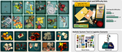
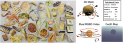
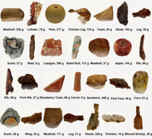

Selected publications, organized around the four application areas of my research on interactive digital twins. For the complete list of 93 papers, please see my [Google Scholar profile](https://scholar.google.com/citations?user=qc6CJjYAAAAJ).

In the author lists below, **my name is in bold** and the names of <u>students and interns I supervise or have supervised</u> — graduate, undergraduate and visiting — are underlined.

## Datasets

### MetaGraspNet

A comprehensive dataset for robotic grasping and manipulation research.
[View on GitHub](https://github.com/maximiliangilles/MetaGraspNet?tab=readme-ov-file)

### MetaFood3D Dataset

A large-scale dataset for 3D food analysis and understanding.
[Access Dataset](https://lorenz.ecn.purdue.edu/~food3d/)

### NutritionVerse 3D

A comprehensive dataset for nutritional analysis of food items in 3D.
[View on Kaggle](https://www.kaggle.com/datasets/amytai/nutritionverse-3d)

---

## Food

Video-based dietary monitoring, 3D food geometry and portion measurement, and generative models for food.

1. **Y. Chen**, G. Vinod, S. Raghavan, T. I. Mahmud, B. Coburn, J. Ma, F. Zhu, and J. He, "Implicit-Scale 3D Reconstruction for Multi-Food Volume Estimation from Monocular Images," in *IEEE Southwest Symposium on Image Analysis and Interpretation (SSIAI)*, 2026, pp. 61–64.

2. J. He, **Y. Chen**, G. Vinod, X. Zhang, T. I. Mahmud, A. AlMughrabi, U. Haroon, R. Marques, P. Radeva, Y. Jueluo, C. Shi, P. Wang, P. Xi, A. Wong, and F. Zhu, "Physically Informed 3D Food Reconstruction: Methods and Results," *IEEE Journal of Biomedical and Health Informatics*, 2026.

3. X. Pan, **Y. Chen**, J. He, and F. Zhu, "Food Image Generation on Multi-Noun Categories," in *IEEE/CVF Winter Conference on Applications of Computer Vision (WACV)*, 2026.

4. <u>E. Z. Zeng</u>, **Y. Chen**, and A. Wong, "SCALEX: Scalable Concept and Latent Exploration for Diffusion Models," in *IEEE/CVF Winter Conference on Applications of Computer Vision (WACV)*, 2026.

5. X. Pan, **Y. Chen**, and F. Zhu, "Training-Free Text-to-Image Compositional Food Generation via Prompt Grafting," in *IEEE Conference on Artificial Intelligence (CAI)*, 2026, pp. 1282–1289.

6. <u>F. Wu</u> and **Y. Chen**, "FruitNinja: 3D Object Interior Texture Generation with Gaussian Splatting," in *IEEE/CVF Conference on Computer Vision and Pattern Recognition (CVPR)*, 2025, pp. 11051–11060.

7. C.-e. A. Tai, <u>M. Keller</u>, <u>S. Nair</u>, **Y. Chen**, <u>Y. Wu</u>, <u>O. Markham</u>, K. Parmar, P. Xi, and A. Wong, "NutritionVerse3D2D: Large 3D Object and 2D Image Food Dataset for Dietary Intake Estimation," *Data*, vol. 10, no. 11, p. 180, 2025.

8. <u>J. Li</u>, <u>F. J. Peña Cantu</u>, <u>E. Yu</u>, A. Wong, Y. Cui, and **Y. Chen**, "SAMJAM: Zero-Shot Video Scene Graph Generation for Egocentric Kitchen Videos," in *CVPR Workshops*, 2025, pp. 467–473.

9. <u>K. Shah</u>, <u>S. Viswanath</u>, P. Xi, A. Wong, and **Y. Chen**, "FoodVideoQA: A Novel Baseline Framework for Dietary Monitoring," in *CVPR Workshops*, 2025, pp. 458–466.

10. J. Valdes, S. Liu, S. Yang, **Y. Chen**, A. Wong, and P. Xi, "Food Degradation Analysis Using Multimodal Fuzzy Clustering," in *CVPR Workshops*, 2025, pp. 420–429.

11. **Y. Chen**, J. He, C. Czarnecki, G. Vinod, T. I. Mahmud, S. Raghavan, J. Ma, <u>D. Mao</u>, <u>S. Nair</u>, P. Xi, A. Wong, E. Delp, and F. Zhu, "MetaFood3D: Large 3D Food Object Dataset with Nutrition Values," arXiv:2409.01966, 2024.

12. <u>A. Sharma</u>, C. Czarnecki, **Y. Chen**, P. Xi, L. Xu, and A. Wong, "How Much You Ate? Food Portion Estimation on Spoons," in *CVPR Workshops*, 2024, pp. 3761–3770.

13. <u>E. Z. Zeng</u>, **Y. Chen**, and A. Wong, "Understanding the Limitations of Diffusion Concept Algebra Through Food," in *MetaFood Workshop, CVPR*, 2024.

14. <u>A. Pathiranage</u>, C. Czarnecki, **Y. Chen**, P. Xi, L. Xu, and A. Wong, "In the Wild Ellipse Parameter Estimation for Circular Dining Plates and Bowls," in *MetaFood Workshop, CVPR*, 2024.

15. C.-e. A. Tai, <u>M. Keller</u>, <u>S. Nair</u>, **Y. Chen** (corresponding author), <u>Y. Wu</u>, <u>O. Markham</u>, K. Parmar, P. Xi, H. Keller, S. Kirkpatrick, and A. Wong, "NutritionVerse: Empirical Study of Various Dietary Intake Estimation Approaches," in *8th ACM International Workshop on Multimedia Assisted Dietary Management*, 2023, pp. 11–19.

16. <u>O. Markham</u>, **Y. Chen**, A. Tai, and A. Wong, "FoodFusion: A Latent Diffusion Model for Realistic Food Image Generation," in *New in Machine Learning Workshop, NeurIPS*, 2023.

17. <u>S. Nair</u>, A. Tai, **Y. Chen**, and A. Wong, "NutritionVerse-Synth: An Open Access Synthetically Generated 2D Food Scene Dataset for Dietary Intake Estimation," in *New in Machine Learning Workshop, NeurIPS*, 2023.

18. G. Sinha, K. Parmar, H. Azimi, A. Tai, **Y. Chen**, A. Wong, and P. Xi, "Transferring Knowledge for Food Image Segmentation Using Transformers and Convolutions," in *2nd Workshop on Computer Vision in the Wild, CVPR*, 2023.

## Sports

Reconstructing players and gameplay from broadcast video: 3D human mesh recovery, rink registration, action recognition, tracking, and puck localization.

1. Z. Wang, A. Nazemi, S. Rambhatla, **Y. Chen**, and D. A. Clausi, "Game Context-Aware 3D Human Mesh Recovery in Ice Hockey," in *CVPR Workshops*, 2026, pp. 10077–10086.

2. M. Koshkina, T. Pilla, A. Nazemi, **Y. Chen**, J. S. Zelek, and D. A. Clausi, "Transition-Constrained Sequence Modeling for Fine-Grained Skating Action Recognition," in *CVPR Workshops*, 2026, pp. 10028–10037.

3. M. Koshkina, **Y. Chen**, J. S. Zelek, and D. A. Clausi, "A Lightweight Tracking-Based Motion Stream for Hockey Skating Action Recognition," in *9th International Workshop on Multimedia Content Analysis in Sports (MMSports), ACM Multimedia*, 2026.

4. Z. Wang, A. Nazemi, S. Liu, S. Rambhatla, **Y. Chen**, and D. A. Clausi, "Boundary-Aware Semantic Segmentation for Ice Hockey Rink Registration," *Computer Vision and Image Understanding*, p. 104627, 2025.

5. <u>K. Buzko</u>, A. Nazemi, D. A. Clausi, and **Y. Chen**, "Ice Hockey Action Recognition via Contextual Priors," in *Linköping Hockey Analytics Conference (LINHAC)*, 2025. **Best Research Paper Award**

6. D. Khanna, J. Bright, **Y. Chen**, and J. Zelek, "SportMamba: Adaptive Non-Linear Multi-Object Tracking with State Space Models for Team Sports," in *CVPR Workshops*, 2025, pp. 6143–6153.

7. L. Salass, J. Bright, A. Nazemi, **Y. Chen**, J. Zelek, and D. Clausi, "Ice Hockey Puck Localization Using Contextual Cues," in *CVPR Workshops*, 2025, pp. 6060–6069.

8. J. Bright, Z. Wang, <u>D. Klepachevskyi</u>, **Y. Chen**, S. Rambhatla, D. A. Clausi, and J. S. Zelek, "Avatar4D: Synthesizing Domain-Specific 4D Humans for Real-World Pose Estimation," arXiv:2512.16199, 2025.

9. J. Bright, **Y. Chen**, and J. S. Zelek, "DreamPose3D: Hallucinative Diffusion with Prompt Learning for 3D Human Pose Estimation," arXiv:2511.09502, 2025.

10. J. Bright, Z. Wang, **Y. Chen**, S. Rambhatla, D. A. Clausi, and J. S. Zelek, "Gen4D: Synthesizing Humans and Scenes in the Wild," in *Computer Vision in the Wild Workshop, CVPR*, 2025.

11. B. Balaji, J. Bright, **Y. Chen**, S. Rambhatla, J. S. Zelek, and D. A. Clausi, "Seeing Beyond the Crop: Using Language Priors for Out-of-Bounding Box Keypoint Prediction," in *Advances in Neural Information Processing Systems (NeurIPS)*, 2024, pp. 102897–102918.

12. J. Bright, B. Balaji, H. Prakash, **Y. Chen**, D. A. Clausi, and J. S. Zelek, "Distribution and Depth-Aware Transformers for 3D Human Mesh Recovery," in *Conference on Robots and Vision (CRV)*, 2024. **Best Paper Award**

13. J. Bright, B. Balaji, **Y. Chen**, D. A. Clausi, and J. S. Zelek, "PitcherNet: Powering the Moneyball Evolution in Baseball Video Analytics," in *CVPR Workshops*, 2024, pp. 3420–3429.

14. B. Balaji, J. Bright, S. Rambhatla, **Y. Chen**, A. Wong, J. S. Zelek, and D. A. Clausi, "Domain-Guided Masked Autoencoders for Unique Player Identification," in *Conference on Robots and Vision (CRV)*, 2024.

15. H. Prakash, J. C. Shang, K. M. Nsiempba, **Y. Chen**, D. A. Clausi, and J. S. Zelek, "Multi Player Tracking in Ice Hockey with Homographic Projections," in *Conference on Robots and Vision (CRV)*, 2024.

16. V. Chomko, **Y. Chen**, D. Clausi, and A. Wong, "Synthetic Local Data Augmentation," in *IEEE 26th International Workshop on Multimedia Signal Processing (MMSP)*, 2024.

17. J. C. Shang, **Y. Chen**, M. J. Shafiee, and D. A. Clausi, "Rink-Agnostic Hockey Rink Registration," in *6th ACM International Workshop on Multimedia Content Analysis in Sports*, 2023, pp. 73–81.

18. B. Balaji, J. Bright, H. Prakash, **Y. Chen**, D. A. Clausi, and J. Zelek, "Jersey Number Recognition Using Keyframe Identification from Low-Resolution Broadcast Videos," in *6th ACM International Workshop on Multimedia Content Analysis in Sports*, 2023, pp. 123–130.

19. J. Bright, **Y. Chen**, and J. Zelek, "Mitigating Motion Blur for Robust 3D Baseball Player Pose Modeling for Pitch Analysis," in *6th ACM International Workshop on Multimedia Content Analysis in Sports*, 2023, pp. 63–71.

## Construction

Long-term UAV-based monitoring of outdoor construction sites: change detection, progress monitoring, and large-scale reconstruction.

1. <u>D. Mao</u>, <u>Y. Lin</u>, A. Ebadi, J. S. Zelek, A. Wong, and **Y. Chen**, "iVISION-2DCD: A Long-Term Change Detection Dataset for Large-Scale Outdoor Construction Monitoring," arXiv:2607.03553, 2026.

2. <u>L. Zhou</u>, <u>D. Mao</u>, <u>Y. Lin</u>, A. Ebadi, A. Wong, and **Y. Chen**, "Reducing Closeup Frequency Artifacts for Level-of-Detail 3D Gaussian Splatting," in *CVPR Workshops*, 2026, pp. 370–378.

3. A. Ebadi, **Y. Chen**, F. Jalaei, <u>D. Mao</u>, and A. Wong, "AI-Driven Insights into Construction Progress Monitoring," *Preprints*, 2026.

4. <u>D. Mao</u>, <u>Y. Lin</u>, Y. S. Hu, <u>M. Gupta</u>, <u>M. Lou</u>, F. Jalaei, S. Razavialavi, A. Ebadi, A. Wong, and **Y. Chen**, "Elevating Construction Progress Monitoring: A Comprehensive UAV-Based System for Long-Term Outdoor Construction Site Mapping," in *CSCE Construction Specialty Conference / ASCE Construction Research Congress (CRC)*, 2025.

## Robotics and Embodied AI

Grasping and bin picking, real-time Gaussian-splatting SLAM, 3D scene graphs, and embodied question answering.

1. <u>Q. Wu</u>, K. Gao, <u>D. Long</u>, D. A. Clausi, J. Li, and **Y. Chen**, "KitchenTwin: Semantically and Geometrically Grounded 3D Kitchen Digital Twins," in *CVPR Workshops*, 2026, pp. 9632–9640.

2. Y. S. Hu, N. Abboud, M. Q. Ali, A. S. Yang, I. Elhajj, D. Asmar, **Y. Chen**, and J. S. Zelek, "MGSO: Monocular Real-Time Photometric SLAM with Efficient 3D Gaussian Splatting," in *IEEE International Conference on Robotics and Automation (ICRA)*, 2025.

3. <u>Y. Xu</u>, F. Zhu, Y. Li, S. Ren, X. Huang, and **Y. Chen**, "RGBSQGrasp: Inferring Local Superquadric Primitives from Single RGB Image for Graspability-Aware Bin Picking," in *IROS Workshop on Benchmarking via Competitions in Robotic Grasping and Manipulation*, 2025. **Best Workshop Paper Award**

4. M. Q. Ali, <u>S. Nair</u>, A. Wong, Y. Cui, and **Y. Chen**, "GraphPad: Inference-Time 3D Scene Graph Updates for Embodied Question Answering," in *Workshop on 3D-LLM/VLA, CVPR*, 2025.

5. <u>F. J. Peña Cantu</u>, J. Lei, V. Agrawal, A. Ramlal, C. Liu, <u>J. Li</u>, <u>S. Nair</u>, <u>Y. Xu</u>, M. Q. Ali, A. Wong, Y. Cui, and **Y. Chen**, "Office Hours: A Multiday Office Cubicle Dataset for Associative Embodied VQA," preprint, 2025.

6. Y. Liu, Y. S. Hu, **Y. Chen**, and J. Zelek, "SplatPose+: Real-Time Image-Based Pose-Agnostic 3D Anomaly Detection," in *European Conference on Computer Vision (ECCV) Workshops*, 2024.

7. Y. Huang, **Y. Chen**, and J. Zelek, "Zero-Shot Monocular Motion Segmentation in the Wild by Combining Deep Learning with Geometric Motion Model Fusion," in *CVPR Workshops*, 2024, pp. 2733–2743.

8. M. Gilles, **Y. Chen**, <u>E. Z. Zeng</u>, <u>Y. Wu</u>, K. Furmans, A. Wong, and R. Rayyes, "MetaGraspNetV2: All-in-One Dataset Enabling Fast and Reliable Robotic Bin Picking via Object Relationship Reasoning and Dexterous Grasping," *IEEE Transactions on Automation Science and Engineering*, 2023.

9. **Y. Chen**, H. Gunraj, <u>E. Z. Zeng</u>, R. Meyer, M. Gilles, and A. Wong, "MMRNet: Improving Reliability for Multimodal Object Detection and Segmentation for Bin Picking via Multimodal Redundancy," in *CVPR Workshops*, 2023, pp. 68–77.

10. A. Wong, <u>Y. Wu</u>, S. Abbasi, <u>S. Nair</u>, **Y. Chen**, and M. J. Shafiee, "Fast GraspNeXt: A Fast Self-Attention Neural Network Architecture for Multi-Task Learning in Computer Vision Tasks for Robotic Grasping on the Edge," in *CVPR Workshops*, 2023, pp. 2292–2296.

11. <u>E. Z. Zeng</u>, **Y. Chen**, and A. Wong, "ShapeShift: Superquadric-Based Object Pose Estimation for Robotic Grasping," in *CVPR Workshops*, 2023.

12. M. Gilles, **Y. Chen** (equal contribution), T. R. Winter, <u>E. Z. Zeng</u>, and A. Wong, "MetaGraspNet: A Large-Scale Benchmark Dataset for Scene-Aware Ambidextrous Bin Picking via Physics-Based Metaverse Synthesis," in *IEEE 18th International Conference on Automation Science and Engineering (CASE)*, 2022, pp. 220–227. **Best Conference and Application Paper Award finalist**
